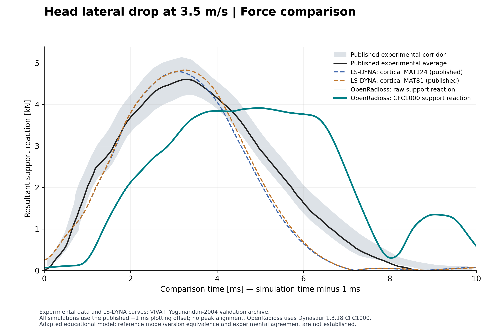

# Your First HBM Simulation with Open Tools

**A student learning project by Yash Kumar Vari.** Inspired by students’ questions on LinkedIn and conversations at IRCOBI 2026 about entering crash simulation and biomechanics.

Learn how a VIVA+ 50F head-drop simulation at 3.5 m/s was adapted for OpenRadioss, how to inspect results, and how to question a force curve. Start with the included data: you do not need a solver license or HPC access to reproduce the figures.

## Start here

1. **Read:** open the guide through the website link in this repository’s About section. Alternatively download the repository using **Code → Download ZIP**, extract it and open `index.html` locally.
2. **Watch:** [smooth five-loop animation](media/head_drop_final_5_loops.mp4), 23.125 seconds in slow motion.
3. **Analyze:** follow the commands below. Four figures and result tables are included.
4. **Ask:** use this repository’s **Discussions → Q&A** for learning questions; use **Issues** for broken instructions and errors.



## Reproduce the analysis

Open Windows Command Prompt in this extracted folder:

```cmd
py -m venv .venv
.venv\Scripts\python.exe -m pip install -r analysis\requirements.txt
.venv\Scripts\python.exe analysis\analyze.py
```

Linux/macOS:

```bash
python3 -m venv .venv
.venv/bin/python -m pip install -r analysis/requirements.txt
.venv/bin/python analysis/analyze.py
```

Outputs go to `figures/` and `analysis/`. Expected filtered support-force peak: approximately **3.913 kN**. The analysis has been executed locally from this layout; the Windows command route is standard Python syntax but has not been independently run on a Windows machine. The raw VTK sequence is not included; the finished MP4 is included.

## What the case teaches

- Model inputs, units, constraints and contact.
- Starter and Engine roles, logs and result checks.
- Why support reaction differs from head-pad contact force.
- Component-wise CFC1000 filtering and careful time-axis interpretation.
- How to document discrepancies and plan a controlled investigation.

## Current result and limits

The final filtered support force is **3.913 kN**, versus the published experimental average of **4.601 kN** (14.95% lower). It peaks 1.635 ms later on the reference plotting convention. Published LS-DYNA curves peak at 4.785 and 4.825 kN. This adaptation has not reproduced the published experimental response. Material translation, contact and exact source-version equivalence require investigation.

The Linux/HPC head-drop run is demonstrated. A complete portable solver installer, the Windows head-run route and independent student reproduction remain unfinished. The guide labels these boundaries rather than promising a turnkey simulation kit. [Methods](docs/METHODS.md) · [Input edits](inputs/README.md) · [Source notices](NOTICE.md).

## Files

| Location | Purpose |
|---|---|
| `index.html`, `assets/` | Student guide and learning illustrations |
| `media/` | Five-loop final animation |
| `figures/` | Four PNG/PDF result figures |
| `analysis/` | Script, raw and processed CSVs, requirements, checksums and upstream filtering dependency |
| `inputs/` | Record of input edits; not a portable installer |
| `docs/` | Methods and student exercises |

## Credits

Original HBM: **VIVA+ team**. Published setup and reference curves: **VIVA+ validation contributors**, using the **Yoganandan head-drop experiments**. Solver: **OpenRadioss community**. Force filtering: **Dynasaur / VSI TU Graz**. Yash Kumar Vari’s contribution is the educational adaptation, execution, troubleshooting, analysis and explanation. This is an independent educational project; no endorsement by Audi, VIVA+ or solver providers is implied.

See [VIVA+ citation instructions](https://vivaplus.readthedocs.io/) and the [reference case](https://vivaplus-validation.readthedocs.io/en/latest/Yoganandan-2004-Head-lateral-drop/Yoganandan-2004.html). This repository is a learning pilot, not an injury-prediction or safety-qualification tool.
